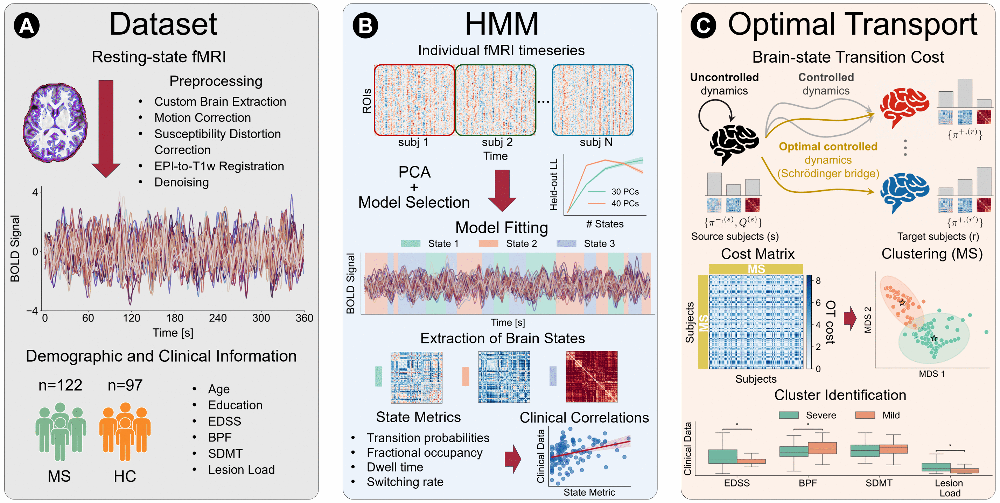

# Discovery of Latent Clinical Phenotypes Through Optimal Transport of Brain Dynamics

## Overview
This repository implements a framework combining Gaussian Hidden Markov Models (HMMs) and Optimal Transport (OT) to quantify inter-individual variability in resting-state brain dynamics. A group-level Gaussian HMM identifies a discrete set of latent brain states characterized by distinct functional connectivity patterns. Individual dynamics are then summarized by state occupancy distributions and transition statistics. Using a Schrödinger bridge formulation of OT, the framework quantifies the minimal modulation of the source subject's state-transition dynamics required to match the target subject's state occupancy distribution. The resulting pairwise dissimilarities capture aspects of temporal brain organization not represented by static functional connectivity alone.

## Application
Applied to resting-state fMRI from relapsing–remitting multiple sclerosis (RRMS) patients and matched healthy controls to study within-cohort heterogeneity and identify data-driven subgroups.

### Notebooks
- [`hmm_ot_main_analysis.ipynb`](./hmm_ot_main_analysis.ipynb) - Main analyses, including Gaussian HMM inference, characterization of brain-state dynamics, and OT-based subject dissimilarities.
- [`hmm_ot_pipeline.ipynb`](./hmm_ot_pipeline.ipynb) - Execution of the full HMM–OT analysis pipeline across different PCA dimensions and numbers of latent states to assess the robustness of the results.
- [`supp_analyses_panels.ipynb`](./supp_analyses_panels.ipynb) - Supplementary analyses and figure/panel generation.

### Data and Figures
- [`data/`](./data/) - Saved results from the HMM–OT analyses.
- [`figures/`](./figures/) - Figures generated from the analyses.

## Libraries
- [Dynamax](https://github.com/probml/dynamax) - Gaussian HMM inference.
- [POT — Python Optimal Transport](https://github.com/PythonOT/POT) - Optimal Transport computations.
